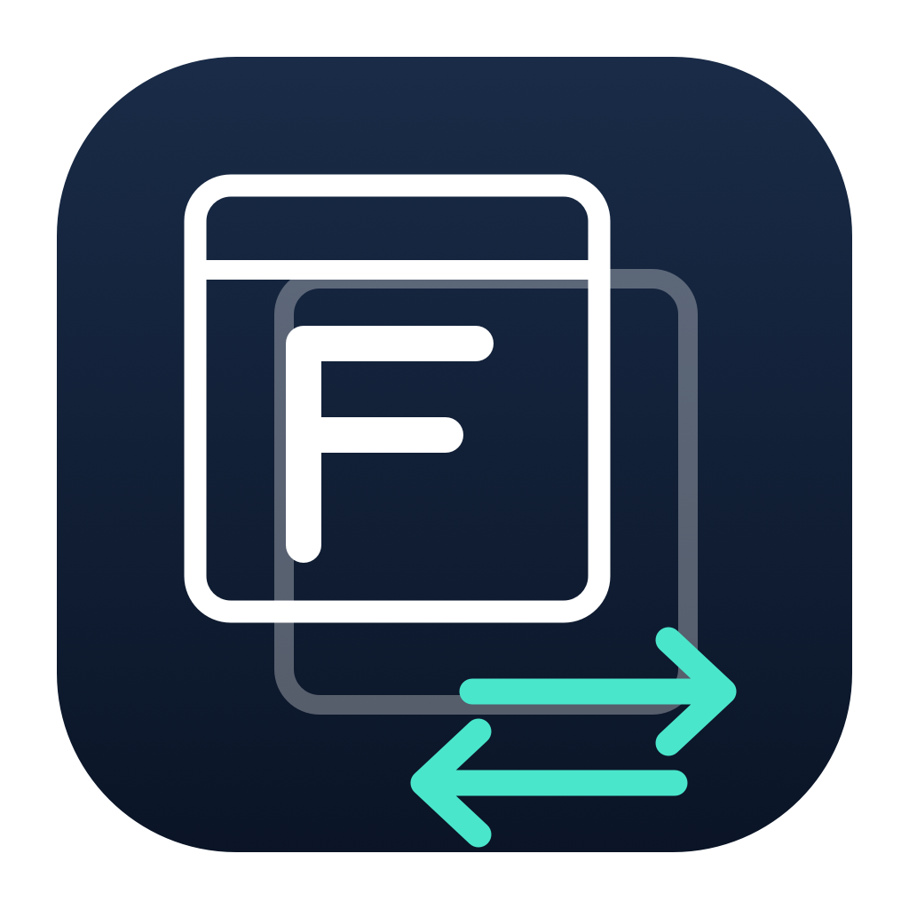

# Free-Alt-Tab

A free, open-source macOS window switcher, based on [AltTab](https://github.com/lwouis/alt-tab-macos) by Louis Pontoise and contributors.

Free-Alt-Tab retains the native AppKit interface and window-switching implementation from AltTab **11.10.1**. All included features are available without a license, account, trial or activation server.

* Switch individual windows across applications, Spaces and displays.
* Choose thumbnails, app icons or window titles, including automatic sizing.
* Search application names and window titles, with ranking and highlighted matches.
* Configure up to nine shortcuts with independent filters and appearance.
* Preview, close, minimize, hide and focus windows; use trackpad gestures or the CLI.
* Import supported AltTab settings after reviewing a summary, with a backup before changes.

## Requirements and building

**Apple silicon · macOS 26.0 or later.** Xcode 27.1 is the reference toolchain. The first release contains source and build instructions; no signed or notarized application is distributed.

See [Building and testing](docs/building.md) for local signing, Debug/Release builds and checks. Dependencies are vendored; building the app does not require npm or a paid Apple developer account.

## Importing settings

Open **Settings → General → Import from AltTab…**. Supported formats are AltTab 10.x and 11.x up to 11.10.1, with a valid `preferencesVersion`.

The preview migrates an isolated copy. Confirming backs up the complete current Free-Alt-Tab settings domain, then replaces supported functional settings. Unset source settings return to defaults. Login startup, permission choices and networking remain independent. Remembered appearance selections are restored; licenses, identity, trial state and usage history are excluded. The original AltTab settings and Keychain are never modified.

Backups are private property lists under `~/Library/Application Support/io.github.stephen2754.free-alt-tab/Settings Backups/`. Use **Import settings…** to restore a functional-settings backup. Quit the original AltTab before restarting Free-Alt-Tab if both applications use the same shortcuts.

## Privacy and updates

Window switching and search run locally. There is no license service, background update check, crash upload or feedback backend. The update button opens this repository's Releases page; feedback opens its Issues page. Local usage counts in About remain on your Mac.

Accessibility permission is required for window switching. Screen Recording permission enables thumbnails and previews; it can be skipped. Free-Alt-Tab has its own permission identity, separate from AltTab.

## Project

* [Upstream provenance and feature parity](docs/upstream.md)
* [Known limitations and manual verification](docs/verification.md)
* [Contributing](docs/contributing.md)
* [License](LICENCE.md) · [Acknowledgments](docs/acknowledgments.md)

Free-Alt-Tab is an independent modified version, not an official AltTab release. It preserves the GPL-3.0 license, upstream copyright notices and contributor history. Changes begin on 2026-10-24.
